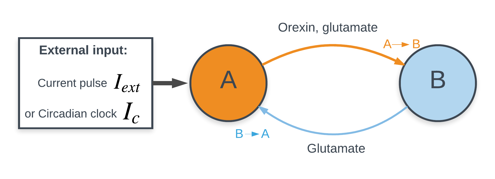

# ModelDB Orexin sleep-wake model (Postnova et al., 2009)

## Simulation of a mathematical model of homeostatic regulation of sleep-wake cycles by hypocretin/orexin

Date: 2017-04-11
Author: Claire Lansonneur
🧠💤

Reproduction and extension of the two-neuron hypocretin/orexin model of sleep-wake regulation by [Postnova, Voigt & Braun (2009)](https://doi.org/10.1177/0748730409346655), written for my final paper in MATH 437 (Mathematical Methods in Biology, McGill University, April 2017).

In the model, an orexin neuron and a glutamate interneuron excite each other, so a brief input can start firing that sustains itself (wake). Each orexin spike also weakens the orexin synapse (homeostatic variable **M** captures activity-dependent synaptic efficacy). Firing stops when M runs low (sleep), and M recovers during silence. Scripts reproduce the paper's pulse and circadian experiments, and extend them to naps and sleep deprivation.

*A: hypocretin/orexin neuron in the lateral hypothalamus. B: local glutamate interneuron. A is driven either by a current pulse (Iext) or by a circadian input (Ic).*

> **Status:** 2017 code. In progress: Python reimplementation that regenerates every figure.

## Content

`legacy/xpp`: 2017 XPPAUT scripts (one per simulation)

| Script | Simulation | Postnova 2009 |
|---|---|---|
| `fig2_10s_stim.ode` | No feedback, long pulse | Fig 2 |
| `fig3_feedback_reciprocal_excitatory.ode` | Reciprocal excitation, 0.5 s pulse | Fig 3 |
| `fig4a_nap.ode` | Firing interrupted by a hyperpolarising pulse | Fig 4a |
| `fig4b_sleep_deprivation.ode` | Firing prolonged by extra current (sleep deprivation) | Fig 4b |
| `fig5_22h.ode`, `fig5_25h.ode`, `fig5_28h.ode` | Second pulse at different times | Fig 5 |
| `fig6_circadian.ode` | Skewed-sine circadian drive | Fig 6 |
| `ext_circadian_sleep_deprivation.ode` | Sleep deprivation on the circadian model | extension |
| `ext_24h_alarm_nap.ode` | Daily "alarm-clock" pulse with a nap | extension |

The full list, including earlier variants, is in [legacy/README.md](legacy/README.md).

## Implementation

1. Install [XPPAUT](https://sites.pitt.edu/~phase/bard/bardware/xpp/xpp.html) (free). Tutorials: [original](http://www.math.pitt.edu/~bard/bardware/tut/start.html), [newer](https://ramcdougal.com/xpp.html).
2. Open an `.ode` file in XPPAUT and run it (fourth-order Runge-Kutta).
3. Export time series from XPPAUT and plot them (e.g., Python).

## Citation

Cite the original model:

> Postnova S, Voigt K, Braun HA (2009). A mathematical model of homeostatic regulation of sleep-wake cycles by hypocretin/orexin. *Journal of Biological Rhythms* 24(6):523–535. https://doi.org/10.1177/0748730409346655

## License

MIT for the code in this repository. The model is the scientific work of Postnova, Voigt and Braun (2009).
